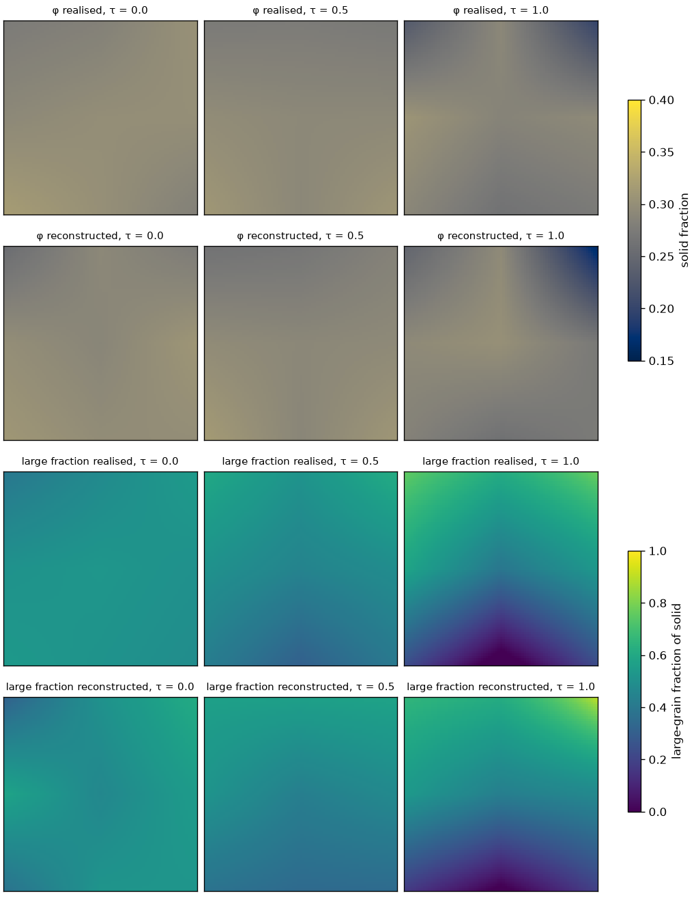
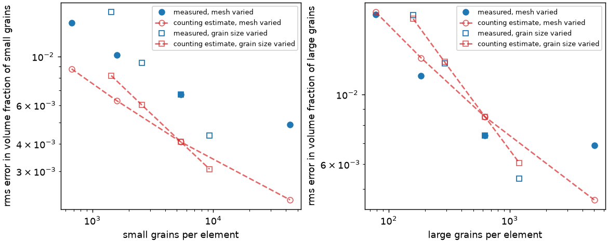
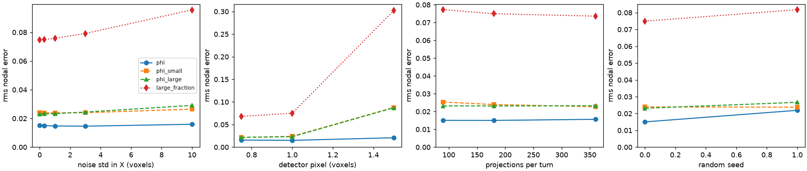
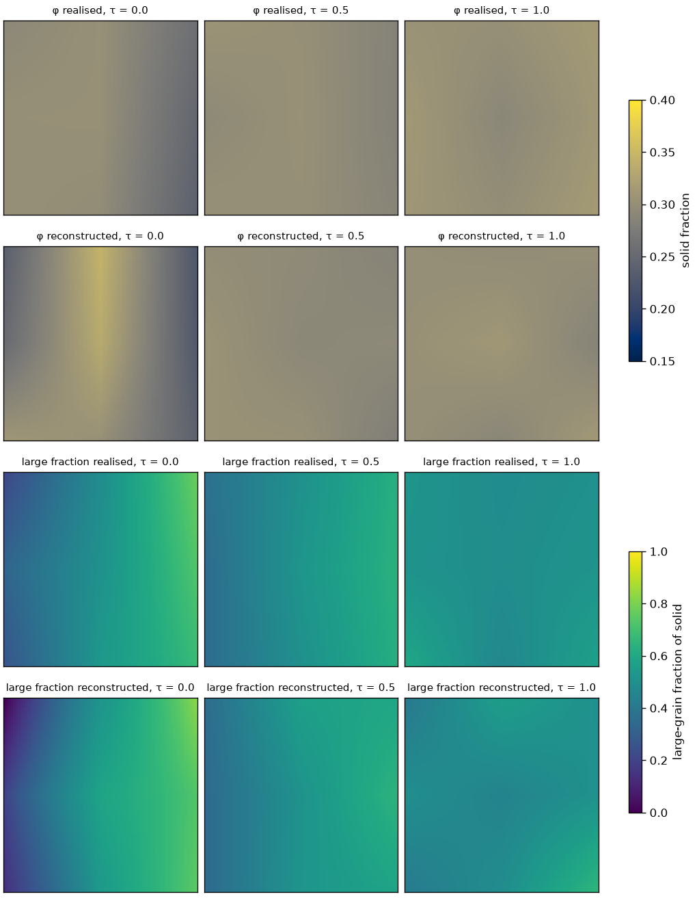

# Granular fields from rotating radiography

Research note on combining projection-based digital volume correlation with
the spectral analysis of radiographs, for experiments on the DynaTOM.

## Purpose

The DynaTOM rotates its source and detector around a stationary specimen and
records radiographs continuously. Two lines of work are relevant to what it
can measure.

- Projection-based digital volume correlation (P-DVC) measures a
  displacement field in 3D and in time from that stream of radiographs. It
  is implemented in `pynamix.pdvc`.
- The spectral analysis in `pynamix.spectral` measures solid fraction, grain
  size (Sauter mean diameter) and per-species velocities from the Fourier
  spectrum of a radiograph. It works on a single view, so what it returns is
  an average through the thickness of the specimen.

This note describes how the two could be combined so that the rotation of
the DynaTOM turns the spectral quantities into 3D fields that evolve in time.
It is a plan with a first prototype, not a finished method.

## From DIC to P-DVC

### DIC

Digital image correlation compares a reference image with a deformed one.
The deformed image is assumed to be the reference with its texture moved:
f(x) = g(x + u(x)). The displacement field u is described by a few unknowns,
for example values at the nodes of a finite-element mesh, and they are found
by minimising the grey-level difference between the two images. Global
(finite-element) DIC solves for all nodes at once with Gauss–Newton
iterations. Local (subset) DIC solves for each subset separately.

### DVC

Digital volume correlation is the same idea in 3D. The images are volumes
reconstructed by X-ray tomography and the mesh is made of hexahedra. The
difficulty is time. A tomographic scan needs hundreds to thousands of
radiographs over at least half a turn, which takes from seconds to hours, and
the specimen must stay still for all of it. Loading is therefore stopped for
each scan, and anything that happens between scans is not seen.

### P-DVC

Projection-based DVC, developed mainly by Roux, Hild and co-workers, skips
the reconstruction during loading. Only one full scan is made, of the
undeformed specimen, and it gives the reference volume f0. During loading
the gantry keeps turning and each radiograph is taken at a different angle
and a different time. The model for radiograph i is:

1. deform the reference volume with the current displacement estimate,
   f(x, t_i) = f0(x − u(x, t_i));
2. project it along the rays of pose i to get a predicted radiograph;
3. compare it with the measured radiograph.

The displacement is written as a coarse mesh in space times a few basis
functions in time, so the whole loading history has a few hundred to a few
thousand unknowns. A radiograph has 10^5 to 10^6 pixels, so a single
radiograph per time step already gives far more equations than unknowns.
The unknowns are found by Gauss–Newton, as in global DIC, with the image
gradient replaced by the gradient of the reference volume summed along each
ray.

The relation to DIC is close. P-DVC is global DIC in which the "image" is a
line integral of the deformed volume instead of the deformed image itself.
It inherits the same requirements: the texture must still match the
reference, and the motion between the current estimate and the solution must
be smaller than about one feature size.

`pynamix.pdvc` implements this on synthetic data, together with grey-level drift
corrections, a coarse-to-fine scheme and material moving in and out of the
field of view (see `docs/pdvc/README.md`).

### Where P-DVC stops

P-DVC tracks texture. In a granular flow the grains rearrange, and after a
shear strain of order one the texture no longer resembles the reference scan.
It also says nothing directly about solid fraction or grain size. Those are
statistical properties of the packing, not of a particular arrangement of
grains.

## Spectral measurements already available

`pynamix.spectral` treats a radiograph of a dense packing as a random field
and models its power spectrum. In the thick-sample limit the spectrum of the
projected solid path length is

    P(q) = <X> v F²(qd/2) S(q)

with <X> the mean path length through solid, v and d the grain volume and
diameter, F the form factor of a sphere and S the structure factor of the
packing. From this, with no calibration:

- the high-q tail (Porod regime) gives the specific surface and hence the
  Sauter mean diameter d32;
- the high-q self term of a mixture gives each species' volume fraction;
- the cross-spectrum between two radiographs gives a displacement per
  species, because each species weights the spectrum differently.

These methods need no reference scan and no grain-by-grain tracking. They
apply to flowing material where P-DVC fails. Their limitation is geometric:
each radiograph gives one number per patch, averaged through the whole
specimen along the beam. A segregated layer that varies with depth cannot be
distinguished from a uniform mixture.

## Combining the two

### Spectral fields

Grains far apart along a ray are uncorrelated. The spectrum of a patch of
the detector is therefore the sum of contributions from every depth that
the patch's rays pass through. At high q, where the interference terms are
small, the contribution from depth s is proportional to the local volume
fraction of each species, with a known kernel that depends on grain size and
magnification. The patch mean of the path length is the line integral of the
total solid fraction.

The same ray machinery P-DVC uses can then be reused. Write each species'
volume fraction as a coarse mesh in space times basis functions in time.
Every patch of every radiograph gives a few linear equations in those nodal
values, and each radiograph is taken from a different angle. Solving them is
a linear tomography problem for slowly varying fields. Small-angle-scattering
tomography is built on the same principle. Solid fraction and Sauter mean
diameter follow from the species fractions at each point.

No reference scan is needed for this. Only the grain sizes and the
calibrated geometry are needed.

### Species velocities

The cross-spectrum method compares two radiographs at the same pose. On the
DynaTOM consecutive radiographs differ by a small rotation, which shifts
grains at different depths by different amounts. That shift follows from the
geometry and can be removed. The phase of the cross-spectrum then gives a
velocity per species per patch, weighted through the depth by that species'
local volume fraction. This is again a projection of a 3D field, here a
vector field, and the rotating views allow it to be reconstructed in 3D.
Whether all three velocity components are recoverable has to be checked on
synthetic data.

### Mass conservation

Each species obeys ∂φ_a/∂t + ∇·(φ_a v_a) = 0. Fractions and velocities
measured separately must satisfy this, which gives either a consistency check
or a constraint that couples the two fits. The segregation flux, the motion
of one species relative to the mixture, comes out of the same equation.

### Where P-DVC fits

In slow or quasi-static tests the texture survives, and P-DVC gives the full
displacement field. Its volumetric strain and the spectral solid fraction
must then agree, which tests both methods. Spectral velocities could also
provide the initial guess that P-DVC needs when the motion is large.

## First prototype

`pynamix/spectral/tomography.py` implements the species volume fraction part
and `examples/pdvc/segregation.py` tests it on synthetic data.

### Test case

A cylinder of spheres of two sizes (diameters 5 and 10 voxels, radius and
half-height 128 voxels, about 34 000 grains; other sizes, size ratios and
size distributions in the studies below) is imaged while the gantry
turns once, with 180 radiographs. During the turn the solid fraction
decreases with height and a dilated column grows off the axis, and the
initially mixed packing segregates, with large grains moving up and
outwards. Twelve packings, drawn from the target fields at successive times,
stand in for the evolving specimen; each is seen by 15 consecutive
radiographs. The radiographs are exact cone-beam path lengths through every
sphere, with Gaussian detector noise.

Each radiograph is cut into 48-pixel patches for the spectra and 16-pixel
patches for the mean path length. The two species' volume fractions are
reconstructed on a 2 x 2 x 2 element mesh with four time knots, and compared
with the fields the packings actually contain (computed from the grains
themselves, not from the targets the packings were drawn from).

### Results

Errors are rms differences over points filling the specimen and 11 times
through the turn, against the fields the packings realised. The kernel
includes grain interference (Percus-Yevick partial structure factors at the
mean composition of a first reconstruction).

In the default case (2 x 2 x 2 mesh, 4 time knots, pixel = 1 voxel at the
detector, noise 0.3 voxels of path length per pixel) the errors are 0.0045 in
solid fraction, 0.0067 and 0.0074 in the small and large volume fractions,
0.023 in the large-grain fraction of the solid and 0.10 voxels in the Sauter
mean diameter (which ranges from 5 to 10). The segregation pattern at the
end of the turn and the dilated column are both recovered.

Grain interference. Leaving the interference out biases the spectra by up
to 6% in the default band and 22% just below it. Including it halves the
species errors in the default case and, with a coarse pixel, cuts them by a
factor of four.

Grains per element. The meshes were refined on the same data, and the
grains made smaller at a fixed mesh with the pixel scaled to keep the
resolution per grain. Both series fall on one curve. For the large grains
the error matches a counting estimate with no fitted parameter: the Poisson
variance of the grain count, reduced by the partial structure factor at
q -> 0 (S_ll(0) = 0.42 here), projected onto the mesh. Large-grain errors
fall as the inverse square root of the number of large grains per element,
from 0.018 at 78 per element to 0.0054 at 1200, and stop falling near 0.005.
Small-grain errors are about 1.6 times their own counting estimate. They
are not a separate problem: the patch means fix the total φ_small + φ_large
closely, so the large-grain error reappears with the opposite sign in the
small-grain field (the errors of the two are correlated at -0.6 to -0.8).
The natural outputs are therefore the solid fraction and the large-grain
fraction of the solid, with φ_small derived from them.

Other settings, varied one at a time from the default:

- Detector noise up to 3 voxels of path length per pixel (about 4% of the
  path through the centre) changes the errors by less than 0.001; at 10
  voxels (13%) the large-grain fraction error rises from 0.023 to 0.034.
- 90, 180 or 360 radiographs per turn give the same errors.
- Pixels of 0.75 and 1 voxel give similar errors; at 1.5 voxels the band is
  q d_small = 6.9-8.9 and the species errors grow by a factor of 1.5-2.
- A second seed gives errors 10-30% higher, which sets the scale of
  differences that mean anything in these comparisons.
- Size ratios of 1.5, 2 and 3 give large-grain fraction errors of 0.030,
  0.023 and 0.035. A larger ratio separates the species more easily but,
  at fixed solid fraction, leaves fewer large grains per element (193 at a
  ratio of 3 against 626 at 2), and the counting floor wins.

Time resolution. With the change compressed into half or a quarter of the
turn, and a reference on a fine time basis, four knots per turn remain the
best choice: the large-grain fraction error is 0.026, 0.025 and 0.029 for a
change over the whole, half and quarter turn. Three knots cannot follow a
quarter-turn change (0.041); six or eight add unknowns and noise (0.035-0.042).

Three dimensions against layers. As a baseline, the same radiographs were
fitted with fields constant across each horizontal layer, which is what a
method assuming no lateral variation could recover. Against a common 3D
reference the large-grain fraction errors are:

| Phantom | 3D | Layers only |
|---|---|---|
| Segregation mainly with height (default) | 0.023 | 0.028-0.032 |
| Lateral segregation and a twist with height | 0.024 | 0.050 |
| Side-to-side segregation turning by 90° during the turn | 0.027 | 0.109 |

The gain from 3D grows with the lateral structure, as it should; on the
mostly layered default phantom the lateral signal in the realised fields
(0.008 in φ_large) is no larger than the reconstruction error, so little
can be gained there.

Ends of the sequence. The first and last time knots are constrained by
radiographs on one side only, and the errors there are about twice those
in the middle of the turn (0.04 against 0.02 in the large-grain fraction).
In an experiment the acquisition should start before and end after the
period of interest.

Local interference. Kernels that follow the local large-grain fraction,
taken from the previous reconstruction and interpolated between five
compositions, change the errors by less than 0.0002 on both the default and
the lateral phantom. The mean composition is enough for the range of
compositions here (large-grain fraction 0.2-0.8).

Wall layers. Packings generated against the container wall carry a layer
of crowded grains. Compared in the interior (at least 20 voxels from the
surface), the solid fraction error is 0.011 without a wall layer, 0.017 with
one, and 0.013 with one when the model has a field confined to a shell at
the wall.

Polydispersity. Each population was given a Schulz size distribution
(four bins), with population kernels averaged over their bins and
interference among all eight bins. At a coefficient of variation of 0.25
the volume fraction errors are 0.010-0.014 (pixel 0.75 to 1 voxel), and at
0.5 they are 0.009 and 0.016, with d32 to 0.18-0.25 voxels. A model with
only solid fraction and specific surface (the Porod tail), which needs no
species, gives d32 to 0.20 voxels for single sizes when the band reaches
q d_small = 19, but 0.62-0.64 voxels for the two size distributions, where
the tail at that band is not yet the Porod limit for the small grains. The
population model is the better choice whenever the populations' size
distributions are known, for example from sieving.

Uncertainty. The posterior covariance of the least-squares fit alone
predicts errors three times too small, because the realised fields
themselves are defined only to the counting floor. Adding that floor gives,
over four seeds, 61-80% of points within one predicted standard deviation
for the solid fraction and 64-74% for φ_large (two standard deviations:
89-98%). For φ_small the floor must include the large grains' floor (see
above); with the two taken as independent, 85-89% of points fall within one
standard deviation, so that prediction is conservative.

### Lessons from building the test

These took most of the effort and apply equally to real data.

- Grains per element. Below a few hundred grains of a species per element
  the mesh-scale field is not well defined, and no method can recover it.
  The counting estimate gives the element size needed for a target
  accuracy.
- Wall layers. A packing generated against a wall crowds grains into the
  outermost layer, by 15-45% here. Rays that graze the surface run through
  it for long distances, and a smooth field cannot represent it, so the fit
  distorts the whole field. A shell field at the wall recovers most of the
  accuracy.
- Error model. A patch mean scatters with the number of grains it holds, so
  its absolute error grows as the square root of the path length, and the
  scatter of a spectrum includes the detector noise that was subtracted
  from it. Weighting by a relative error, or leaving out the noise term,
  made the fit fail at the specimen edge and at high noise.
- Forward model details. The annulus width and the window spectrum must be
  included in the model, otherwise the zeros of the form factor give errors
  of up to 40%. Grain interference must be included unless the band lies
  well above q d_small = 10.
- References. Errors must be measured against the fields the packings
  realised, on a basis shared by every reconstruction being compared;
  measuring each against a reference in its own basis hid both the cost of
  too few time knots and the benefit of 3D. A baseline must also be what it
  claims: a mesh with one element across the specimen is still bilinear
  across it, and represents any linear lateral gradient.

## Open questions

- Ends of the sequence. Errors double at the first and last knots; longer
  acquisitions or a temporal penalty would address it.
- Wide size distributions without known populations. The Porod model needs
  a band well into the Porod regime of the smallest grains.
- Wall layers on real packings. The shell field was tested on packings from
  random sequential addition; real wall layering oscillates over a few
  diameters.
- Detector. Real data need flat and dark correction, linearisation for beam
  hardening, the detector blur and the calibrated pose of every radiograph.
  `pynamix.spectral.detector` has much of this for a single view.
- Container. Its wall adds strong edges and its own material to patches
  near the specimen surface.
- Velocities. The rotation-corrected cross-spectrum and the 3D velocity
  reconstruction are not implemented.
- Validation. A packing whose composition is known in 3D, for example layers
  of two sizes, scanned both statically (full CT) and on the DynaTOM.

## Suggested order of work

1. Read the P-DVC literature, starting from the reviews by Roux, Hild and
   co-workers, and run `examples/pdvc/synthetic.py` to see the method work.
2. Run `examples/pdvc/segregation.py`, then extend it to a monodisperse case with a
   solid-fraction gradient, which tests the Porod and mean terms alone.
3. Replace the synthetic radiographs with DynaTOM radiographs of a static,
   layered bidisperse specimen and compare with its full CT scan.
4. Add the rotation-corrected cross-spectrum and reconstruct velocities on
   synthetic flows.
5. Couple fractions and velocities through mass conservation.

## Glossary

- Cone beam: X-rays from a point source onto a flat detector, so features
  closer to the source appear larger (magnification).
- Pose: the source position and detector position and orientation of one
  radiograph.
- Reference volume: the tomographic reconstruction of the specimen before
  loading.
- Self term: the part of a mixture's spectrum from each grain with itself.
  It does not depend on how the grains are arranged.
- Structure factor: the part of the spectrum from correlations between
  grain positions.
- Sauter mean diameter d32: the diameter of a sphere with the same ratio of
  volume to surface area as the whole mixture.
- Time basis: a small set of functions of time (here piecewise linear) whose
  combination describes how each field evolves during the test.
